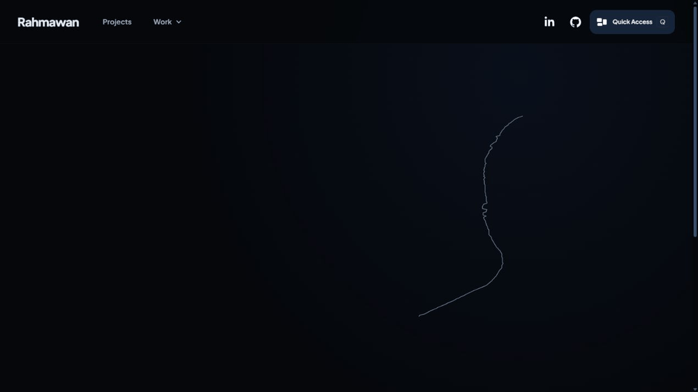
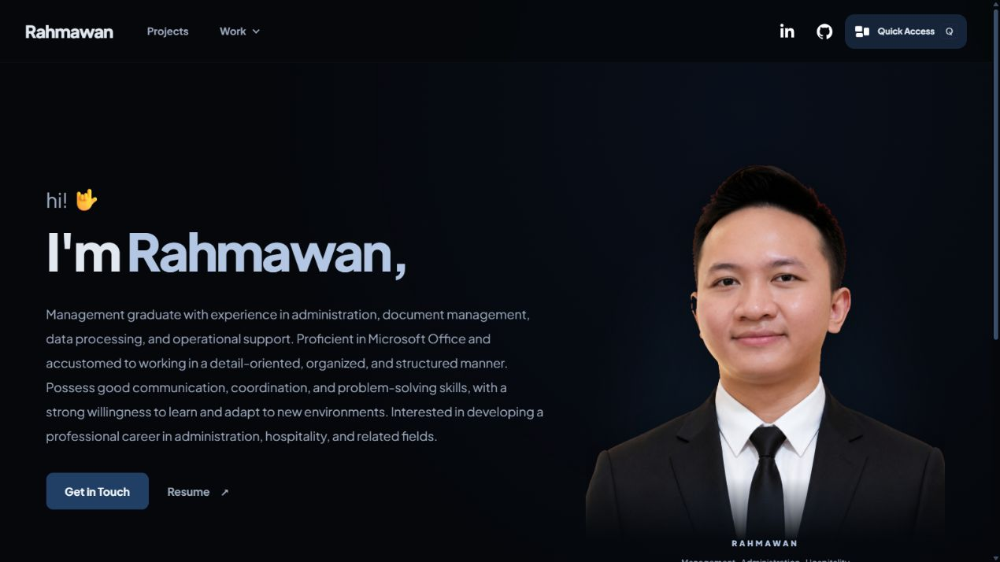
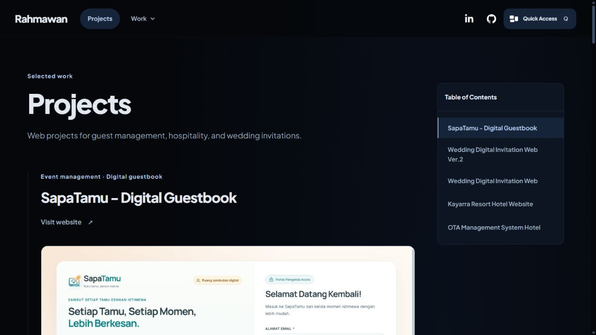
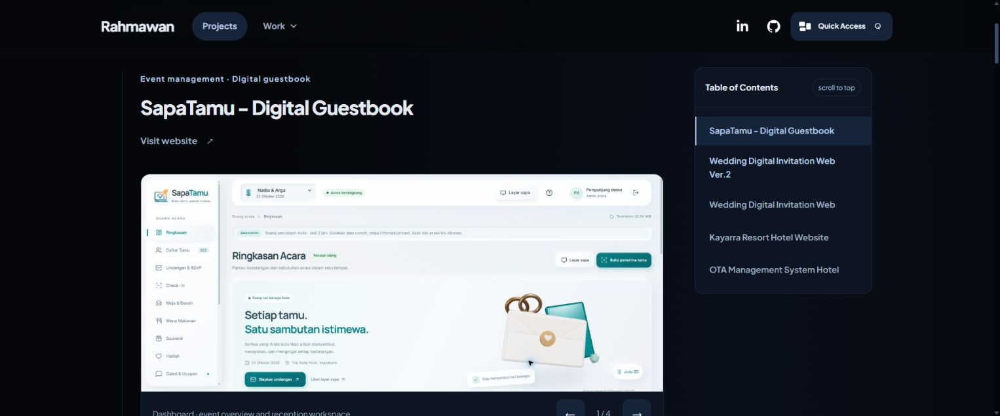
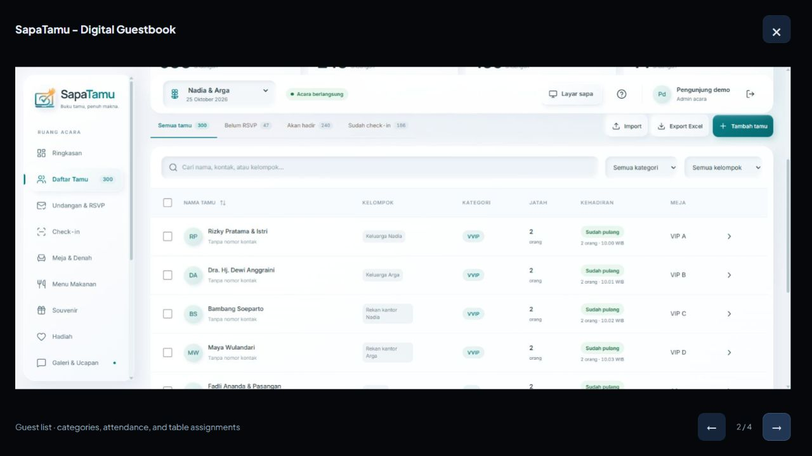
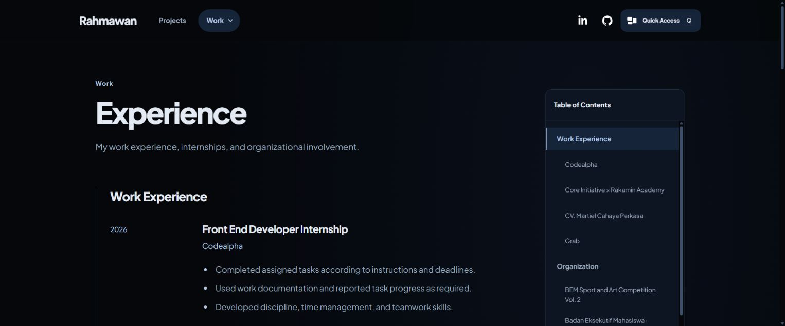
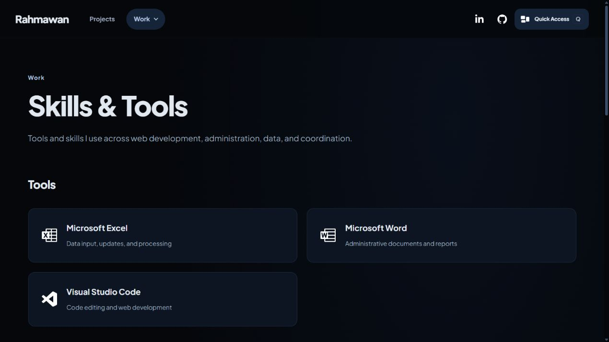
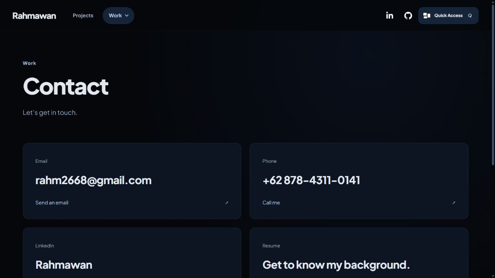
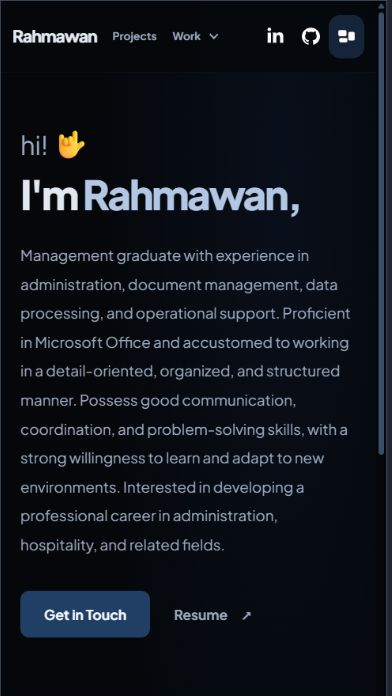
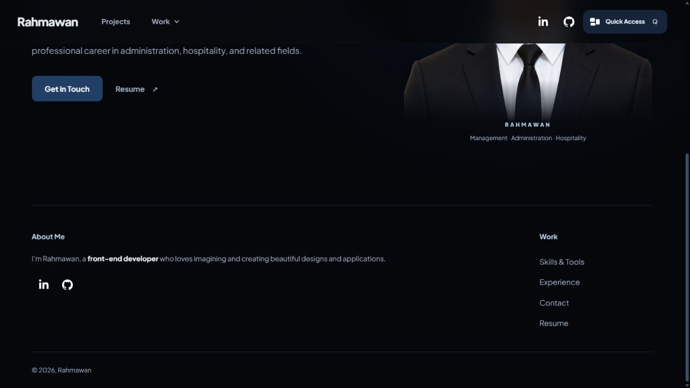

# Rahmawan · Personal Portfolio

[Live website](https://portofolio-website-sigma-liart.vercel.app/) · [Source code](https://github.com/rahm2668-cpu/Portofolio-Website) · [LinkedIn](https://www.linkedin.com/in/rahmawan-9a3395215/)

    

My personal portfolio for front-end projects, professional experience, skills, and contact information. Personalized by **Rahmawan**, with a black/navy palette, my own biography and original portrait, and real project screenshots.

## Preview

### Homepage animation

The greeting, name, profile, and actions enter in sequence. A line traces my portrait silhouette before the original photograph appears. This GIF is recorded from the running website.



### Desktop



### Projects







### Experience navigation



### Skills and contact

| Skills and Tools | Contact |
| --- | --- |
|  |  |

### Mobile



### Short About Me



## Original creator and credits

The original **enji.dev** website, visual design, and reference implementation were created by **[Enji Kusnadi](https://github.com/enjidev)**. This portfolio adapts that visual reference for my own identity and content. I do not claim authorship of the original design.

- Original website: [enji.dev](https://enji.dev/)
- Original source: [enjidev/enji.dev](https://github.com/enjidev/enji.dev)
- Original documentation: [Enji's README](https://github.com/enjidev/enji.dev/blob/main/README.md)
- Motion references: [HeaderTitle](https://github.com/enjidev/enji.dev/blob/main/apps/enji.dev/src/contents/index/Header/HeaderTitle.tsx), [HeaderImage](https://github.com/enjidev/enji.dev/blob/main/apps/enji.dev/src/contents/index/Header/HeaderImage.tsx), and [PageHeader](https://github.com/enjidev/enji.dev/blob/main/apps/enji.dev/src/components/PageHeader.tsx).

The table of contents also follows Enji's [TableOfContents](https://github.com/enjidev/enji.dev/blob/main/apps/enji.dev/src/components/TableOfContents.tsx) and [WithTableOfContents](https://github.com/enjidev/enji.dev/blob/main/apps/enji.dev/src/components/layouts/WithTableOfContents.tsx) references.

The local React implementation, Rahmawan-specific content, project galleries, responsive fixes, and motion adaptation are maintained in this repository. Enji's original application uses Next.js, TypeScript, Framer Motion, Tailwind CSS, and MDX. **This separate adaptation uses React, Vite, JavaScript, Tailwind CSS 4, Tailwind Typography, and custom CSS**, rather than the original Next.js monorepo.

## What I changed

| Area | Personalization and changes |
| --- | --- |
| Identity | Replaced the visible name, page titles, biography, portrait, favicon, and contact details with Rahmawan's information. |
| Theme | Changed the black/purple reference palette to black/navy; retained persistent dark and light modes. |
| Homepage | Kept the personal introduction and actions; removed the original technology and promotional sections below the hero. |
| About Me | Replaced the lengthy footer profile with a short biography emphasizing **front-end developer**. |
| Navigation | Removed Blog, T.I.L, Studio, Services Soon, Learn, and This Site items. Fixed the mobile Work dropdown positioning. |
| Social links | Replaced X/Twitter with my LinkedIn, restored my GitHub link, and removed the Figma social link. |
| Resume and experience | Added my CV, education, work experience, organizational involvement, and certifications. |
| Skills and tools | Added HTML, CSS, React, Next.js, Tailwind CSS, Visual Studio Code, Microsoft Excel, and Microsoft Word with local icons. |
| Projects | Added five personal projects with descriptions, technology logos, live links, and real screenshot galleries. SapaTamu includes four current public-demo screenshots; the other galleries each include three. |
| Table of contents | Added sticky navigation to Projects and Experience, smooth section links, an animated active marker, a scroll-to-top reveal, and a collapsible mobile menu. |
| Typography | Integrated Tailwind CSS 4 through Vite and the official Typography plugin. Shared Prose styles unify biography, project descriptions, and experience bullets; headings balance, paragraphs wrap naturally, and responsive utility classes control grids and spacing. |
| Motion | Added staggered entrances on every page, on-scroll section reveals, a greeting spring, and an outline-to-photo reveal following Enji's sequence. |
| Accessibility | Preserved keyboard navigation, visible focus, swipe/button gallery controls, reduced-motion handling, and Quick Access. |

The homepage profile remains based on my CV; the short developer biography appears in the footer. The portrait is an original-photo cutout. The reveal does not generate, reshape, or retouch my face; its SVG follows the photo's alpha silhouette.

## Featured projects

1. **[SapaTamu - Digital Guestbook](https://sapatamu-eight.vercel.app/)** — reception dashboard, searchable guest lists, invitations and RSVP, QR check-in, seating plans, meals, souvenirs, gifts, guest wishes, and reporting controls. Next.js and React. Four screenshots were captured directly from the public demo on 27 October 2026; all displayed guest/event information is sample data.
2. **[Wedding Digital Invitation Web Ver.2](https://felix-rahmawati-wedding.vercel.app/)** — personalized Felix and Rahma invitation with a curtain opening, couple introduction, sliding gallery, and RSVP form. HTML, CSS, JavaScript.
3. **[Wedding Digital Invitation Web](https://digital-invitation-wedding-pink-mar.vercel.app/)** — interactive invitation, story timeline, countdown, gallery, and browser-local RSVP demo. Next.js and React.
4. **[Kayarra Resort Hotel Website](https://kayarra-official-website.vercel.app/)** — resort accommodation, facilities, photo galleries, and reservation inquiries. Next.js and React.
5. **[OTA Management System Hotel](https://kayarra-ota-management-system.vercel.app/)** — hotel operations portfolio demo with reservations, rates, inventory, and revenue overviews using fictional sample data. Next.js and React.

Project technology labels describe the linked projects, separately from this portfolio's own stack.

## Tech stack

- React 19, JavaScript, and Vite 6.
- Tailwind CSS 4 with `@tailwindcss/vite`, plus `@tailwindcss/typography` for shared readable content.
- Theme-aware Tailwind tokens adapt the existing black/navy and light-mode CSS variables.
- CSS variables, responsive utility classes, local Plus Jakarta Sans fonts, and SVG icons.
- Archived reference layout CSS is no longer loaded; local font declarations are isolated in `fonts.css`.
- Motion (mini engine) for content entrances and left-to-right destination-heading pops with a traveling light/electric streak; IntersectionObserver for viewport reveals.
- Motion for React for gallery crossfades and an enlarged-image viewer with keyboard controls.
- CSS and SVG for the hand spring, silhouette draw, and photo fade.
- Vercel hosting with an SPA fallback for direct page URLs.

Motion powers the shared animation system. With `prefers-reduced-motion: reduce`, entrance effects and gallery movement are skipped, the portrait appears immediately, and destination headings use a static temporary highlight. Page content is visible by default, so readability does not depend on a scroll observer firing.

## Run locally

Install Node.js 20.19+ or 22.12+. npm is included with Node.js.

```sh
git clone https://github.com/rahm2668-cpu/Portofolio-Website.git
cd Portofolio-Website/app
npm install
npm run dev -- --port 4173
```

Open [localhost:4173](http://localhost:4173/). Choose another port if it is already in use.

### Production build and checks

Run these inside `app`:

```sh
npm run build
npm run test:sites
npm run preview -- --port 4173
```

The production files are written to `app/dist/client`. The build also prepares the existing Sites-compatible server and hosting metadata.

## Project structure

```text
app/src/
  tailwind.css         Tailwind entry, theme adapter, and Typography colors
  Prose.jsx            Shared readable paragraphs and lists
  fonts.css            Local font faces without archived layout rules
  Replica.jsx          Pages, header, footer, and screenshot galleries
  TableOfContents.jsx  Shared scroll-spy navigation and mobile contents menu
  contents.css         Sticky contents card, active marker, and responsive states
  Motion.jsx           Shared content reveals and original portrait
  ProjectGallery.jsx   Animated carousel and accessible enlarged-image viewer
  gallery.css          Image viewer and destination-highlight styling
  motion.css           Hand, silhouette, photo, and reduced-motion effects
  QuickAccess.jsx      Theme and Focus dialog
  portfolio-data.js    CV content and project information
  replica.css          Theme tokens, layout, and responsive styling
app/public/assets/
  profile/             Resume PDF and portrait assets
  projects/            Actual screenshots of the five linked projects
docs/media/            README screenshots and animation recording
```

Historical captured files under `app/public/pages` and `app/public/_next` are reference archives. Their original layout stylesheet, application scripts, and analytics are not executed. Existing local font files remain in use. Do not rerun `capture.mjs` for routine content edits.

## Quick Access

Use the header button or press **Q**. **Escape** closes the dialog. Theme and Focus preferences are saved locally. Focus hides the decorative portrait and footer while keeping navigation and Quick Access available.

## Contact

[LinkedIn](https://www.linkedin.com/in/rahmawan-9a3395215/) · [GitHub](https://github.com/rahm2668-cpu) · [Portfolio](https://portofolio-website-sigma-liart.vercel.app/)

Thank you to **Enji Kusnadi** for the original design and publicly available reference implementation.
